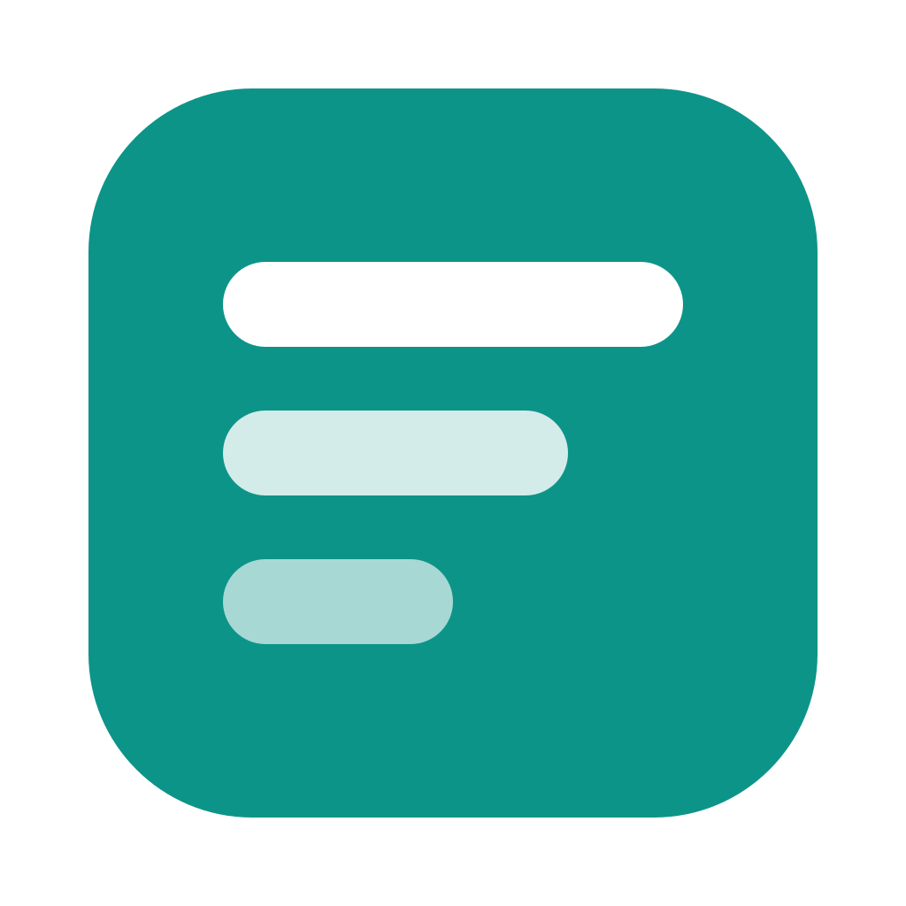

# Prio

Prio keeps your Mac on the microphone and speakers you actually want.

You rank your input and output devices once. Prio keeps the highest-ranked
connected device selected through plugging and unplugging, Bluetooth
reconnects, wake from sleep and login. If macOS switches to something else on
its own, Prio switches back and lets you undo it with one click.

Free and open source (MIT). No account, no license key, no subscription, no
telemetry. Prio makes no network connections.

## Features

- **Two ranked lists.** Inputs and outputs are ranked separately. A headset
  shows up in both lists, and each entry can sit at a different rank.
- **Automatic switching.** The highest-ranked connected device is selected
  whenever devices connect or disconnect, the Mac wakes, or you log in.
- **Corrections with Undo.** When macOS moves the default on its own, Prio
  switches back and posts a notification with an **Undo** button. The last
  action and an Undo button are also shown in the menu.
- **Use only as a last resort.** Untick a device, such as display speakers,
  a webcam mic or a headset's mic, and it is skipped while anything else is
  connected. If it is the only device left, Prio uses it and tells you once.
- **Manual picks stick.** Picking a device in Prio's menu keeps it until it
  disconnects or a higher-ranked device connects. By default, an output you
  pick in Control Center or System Settings is respected too.
- **Bluetooth settling.** Prio waits for reconnecting devices to settle, so
  a burst of events causes one switch, not several.
- **Loop protection.** If another app keeps changing the device, Prio stops
  after 3 corrections in 30 seconds and tells you, instead of fighting it.
- **Pause.** One toggle hands control back to macOS.
- **Menu bar only.** No Dock icon. The menu bar icon shows when the
  microphone is muted and when switching is paused.
- **Launch at login**, quiet notifications, keyboard reordering
  (⌥⌘↑ / ⌥⌘↓), full VoiceOver labels, light and dark appearance.
- **Local diagnostics.** You preview a plain-text report before Prio copies
  it to the clipboard. Device names are hidden unless you include them.

## Requirements

- macOS 13 Ventura or later. Universal binary: Apple silicon and Intel.
- To build: Xcode **or** just the Command Line Tools (`xcode-select --install`),
  Swift 6.

## Build

```sh
git clone https://github.com/highstat/prio.git
cd prio
make app        # → build/Prio.app (universal, ad-hoc signed)
```

Then move `build/Prio.app` to `/Applications` and open it. The build is
ad-hoc signed, not notarized, so macOS asks for confirmation the first time
it opens. Right-click the app and choose **Open**, or allow it in System
Settings › Privacy & Security.

Other targets:

| Command      | What it does                         |
|--------------|--------------------------------------|
| `make test`  | Run the test suite (Swift Testing)   |
| `make run`   | Build and launch the app             |
| `make clean` | Remove build products                |

## First run

1. Prio appears in the menu bar. Allow notifications if you want correction
   alerts with Undo.
2. Open **Settings… › Devices** and drag devices into the order you prefer,
   for Input and for Output.
3. Untick devices you only want as a last resort.
4. In Zoom, Meet, Teams, your DAW and similar apps, set the microphone and
   speaker to **Default** / **Same as System**. Apps pinned to a specific
   device ignore the system default, so they won't follow Prio.

## How Prio decides

For each direction, in this order:

1. Your manual pick, if it is still valid.
2. Otherwise the highest-ranked connected device you haven't unticked.
3. Otherwise the highest-ranked connected unticked device, as a last resort.

A default change that Prio did not make is treated as **macOS** if a device
connected or disconnected in the last 3 seconds, or the Mac woke in the last
5 seconds. Prio corrects it. Otherwise it is treated as **you**:

- **Outputs:** respected by default.
- **Inputs:** corrected by default, because macOS often moves the mic to a
  Bluetooth headset on its own.

Both behaviours can be changed in **Settings › General**.

The full functional specification is in [SPEC.md](SPEC.md).

## Privacy

- Prio never opens an audio stream. It does not ask for microphone access
  and never turns on the recording indicator.
- No network code: no analytics, crash reporting, update checks or
  licensing.
- Settings are stored locally in
  `~/Library/Application Support/Prio/state.json`.

## Limitations

- Apps that select a specific device bypass the system default.
- Prio does not repair Bluetooth connections, change codecs or improve
  mic quality.
- Some USB devices change identity on a different port and show up as a
  new device.
- No per-app routing and no volume mixer.
- No auto-updater. Update by pulling and running `make app` again.

## Project layout

```
Sources/PrioCore    Pure decision logic: ranking, policies, engine (no OS audio APIs)
Sources/PrioAudio   CoreAudio adapter: device properties and listeners only
Sources/Prio        Menu bar app: menu, Settings, notifications, login item
Tests/PrioCoreTests Behaviour tests against a simulated device system and clock
scripts/            App bundle assembly and icon rendering
```

## Origin

Prio is an independent, clean-room implementation. It was written from a
functional specification ([SPEC.md](SPEC.md)) of publicly described
behaviour. No code, text, icons or other assets were taken from any other
product.

## License

[MIT](LICENSE) © 2026 Prio contributors
